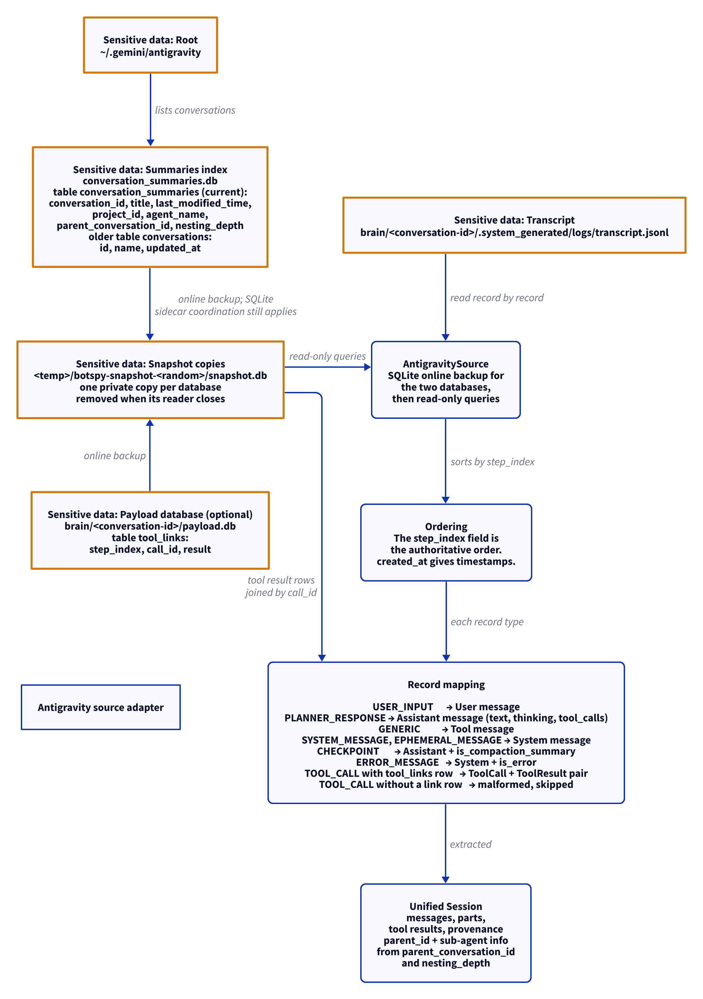

# Antigravity source adapter

This document uses Simplified Technical English.

The Antigravity adapter reads the conversation index and the per-
conversation files under `~/.gemini/antigravity`.

## Where the data lives

| Path | Content |
| --- | --- |
| `~/.gemini/antigravity/conversation_summaries.db` | The summaries index. The current table is `conversation_summaries`. It gives: `conversation_id`, `title`, `last_modified_time`, `project_id`, `agent_name`, `parent_conversation_id`, `nesting_depth`, and other columns. The adapter ignores the other columns and the FTS tables. |
| `~/.gemini/antigravity/brain/<conversation-id>/.system_generated/logs/transcript.jsonl` | The transcript. One JSON record per line. |
| `~/.gemini/antigravity/brain/<conversation-id>/payload.db` | The payload database. It is optional: current installs do not have it. The table `tool_links` gives: `step_index`, `call_id`, `result`. |

## The two index schemas

The adapter looks at which table exists in the summaries index.

| Table | Used when | Columns the adapter reads |
| --- | --- | --- |
| `conversation_summaries` | The table exists (current installs) | `conversation_id`, `project_id`, `title`, `last_modified_time`, `parent_conversation_id`, `nesting_depth`, `agent_name` |
| `conversations` | The current table does not exist (older installs) | `id`, `name`, `updated_at` |

- The `last_modified_time` field is a text datetime with a space
  between the date and the time. The adapter writes it with a `T`, so
  it has the RFC 3339 shape of the other sources.
- The `project_id` field (older schema: `name`) is the project of the
  session.
- A conversation with a `parent_conversation_id` is a sub-agent. The
  session gets `parent_id` from that field. Its sub-agent information
  gets the `agent_name` as the kind (or `subagent` when the name is
  empty) and the `nesting_depth` as the depth.
- A conversation with no parent has no parent and no sub-agent
  information.

## The snapshots

1. The two databases are live: Antigravity writes to them.
2. The adapter copies each one with the SQLite online backup API.
3. The copies land at `$TMPDIR/botspy-ag-snaps/<pid>-<seq>/snapshot.db`.
4. The copies open read-only. The live databases are never written to.
5. `digest_files` proves that the sources were not mutated.

## Discovery

`AntigravityDiscovery` gives the conversation count from the summaries
index. Each summary has the project, the title, and the last activity.

## Extraction and ordering

1. The transcript is read record by record.
2. The `step_index` field, not the file order, is the authoritative
   order. The adapter sorts by `step_index`.
3. The `created_at` fields give the timestamps. A missing time stays
   missing.
4. Each record has the keys `content`, `created_at`, `source`,
   `status`, `step_index`, and `type`. A record can also have
   `thinking`, `tool_calls`, `error`, and token counts. A planner step
   often has no `content`: it has only `thinking` and `tool_calls`.

## Record mapping

| Record type | Unified result |
| --- | --- |
| `USER_INPUT` | A User message |
| `PLANNER_RESPONSE` | An Assistant message: a `Text` part for `content`, a `Thinking` part for `thinking`, and one `ToolCall` part for each entry of `tool_calls` (name and args; the id is `step-<step_index>-<n>`) |
| `GENERIC` | A Tool message with the `content`. It has `is_error` when the record has an `error` |
| `SYSTEM_MESSAGE`, `EPHEMERAL_MESSAGE` | A System message |
| `CHECKPOINT` | An Assistant message with `is_compaction_summary` |
| `ERROR_MESSAGE` | A System message with `is_error`. The text is the `content`, or the `error` when there is no `content` |
| `TOOL_CALL` with a `tool_links` row | A `ToolCall` part and a `ToolResult` part, joined by `call_id` |
| `TOOL_CALL` without a link row | Malformed. Skipped and counted |
| Other types | Unknown. Skipped and counted |

The `TOOL_CALL` type is from older installs. Current installs put the
tool calls in the `tool_calls` field of the planner step.

## Report

`AntigravityReport` gives: the root, the conversation count, the
transcripts, and the issues.

## The diagram

<picture>
  <source media="(prefers-color-scheme: dark)" srcset="../diagrams/antigravity.dark.png">
  
</picture>

## Sensitive data

The adapter reads session content: user input, planner responses,
checkpoints, error text, and tool results. Exact paths:

- `~/.gemini/antigravity/conversation_summaries.db` — read through a
  snapshot copy
- `~/.gemini/antigravity/brain/<conversation-id>/payload.db` — read
  through a snapshot copy
- `~/.gemini/antigravity/brain/<conversation-id>/.system_generated/logs/transcript.jsonl` — read
- `$TMPDIR/botspy-ag-snaps/<pid>-<seq>/snapshot.db` — BotSpy's copies

See [`../sensitive-data.md`](../sensitive-data.md).