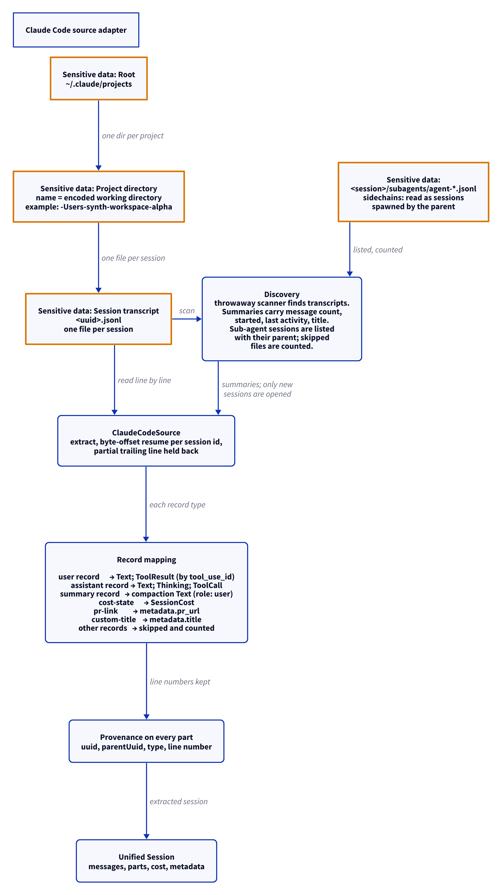

# Claude Code source adapter

This document uses Simplified Technical English.

The Claude Code adapter reads the transcripts that Claude Code writes
under `~/.claude/projects`. One directory holds one project. One
JSONL file holds one session.

## Where the data lives

| Path | Content |
| --- | --- |
| `~/.claude/projects/<encoded-cwd>/` | One directory per project. The directory name is the encoded working directory. Example: `-Users-synth-workspace-alpha`. |
| `<dir>/<uuid>.jsonl` | One file per session. One JSON record per line. |
| `<dir>/<session-id>/subagents/agent-<id>.jsonl` | Sidechain transcripts from sub-agents, with an optional sibling `agent-<id>.meta.json`. |

## Discovery

1. A throwaway scanner walks the project directories.
2. It finds each `*.jsonl` transcript, and each sub-agent transcript under
   `<session-id>/subagents/`.
3. It gives a summary per transcript: message count, started time,
   last activity, and title.
4. It does not open the files for extraction. Only new sessions are
   opened later.
5. `ClaudeDiscovery` gives the counts: `transcripts`,
   `subagents`, `skipped_files`.

Each sub-agent is its own session, with the id
`<parent-session-id>--agent-<id>`. It is spawned by its parent:
`parent_id` is the parent session id, and `subagent` carries the
`agentType` as the kind (or `subagent` without a meta file) and the
`spawnDepth` as the nesting depth. The meta file's `description` becomes
the title and its `model` the session's model. Sidechain records stay in
the sub-agent's session; a sidechain record found in a main transcript is
skipped as unknown.

## Extraction

1. `ClaudeCodeSource` reads the transcript line by line.
2. It keeps a byte offset per session id. The next run resumes at the
   offset.
3. A partial trailing line — Claude Code still writing — is held back
   until the line is complete.
4. Each part keeps provenance: the record uuid, the parent uuid, the
   type, and the line number.

## Record mapping

| Record type | Unified result |
| --- | --- |
| `user` (string content) | A `Text` part |
| `user` (array content) | A `Text` part plus `ToolResult` parts, matched by `tool_use_id` from the tool call |
| `assistant` (array content) | `Text`, `Thinking` (with signature), and `ToolCall` parts (id, name, parsed input) |
| `summary` | A compaction `Text` part on a user-role message |
| `cost-state` | `SessionCost`: total cost in USD, API duration, tool duration, lines added and removed |
| `pr-link` | `metadata.pr_url` |
| `custom-title` | `metadata.title` |
| other (example: `file-history-snapshot`) | Skipped and counted |

## Who wrote a user message

Claude Code stores text that the harness wrote under the user role. The
adapter keeps the role and sets an origin on the message, so a reader can
tell the human's words from the harness text.

| What the record has | Origin |
| --- | --- |
| `origin.kind` is `human` | None. The human typed it, whatever the text looks like |
| `origin.kind` is `peer` | `agent_message`. It is mail from another agent session |
| Any other `origin` key (example: `task-notification`) | `harness` |
| `isMeta: true` (skill bodies, injected context) | `harness` |
| `isCompactSummary: true` | `harness`, and `is_compaction_summary` |
| Text that starts with "This session is being continued from a previous conversation", "Another Claude session sent a message", or "[Request interrupted by user" | `harness` |
| Text that starts with a harness tag (the list below) | `harness` |
| Anything else | None. The human typed it |

The harness tags are `task-notification`, `system-reminder`, `wake`,
`project_claude_message`, `ci-monitor-event`, `relay`,
`artifact-view-context`, `create-pr-command`, `command-name`,
`command-message`, `command-args`, `local-command-stdout`,
`local-command-stderr`, `local-command-caveat`, and
`cross-session-message`. The list is short on purpose. `pasted_content`
and `bash-input` are the human's own input, so they get no origin. The
list is the constant `HARNESS_TAGS` in `src/adapters/claude_code.rs`.

## Report

`ClaudeReport` gives: the root, the project directories, the
transcripts, the sub-agents imported, the skipped files, and the issues.

## The diagram

<picture>
  <source media="(prefers-color-scheme: dark)" srcset="../diagrams/claude-code.dark.png">
  
</picture>

## Sensitive data

The adapter reads session content: prompts, code, thinking traces,
tool output, and costs. Exact paths:

- `~/.claude/projects/<encoded-cwd>/<uuid>.jsonl` — read
- `~/.claude/projects/<encoded-cwd>/subagents/agent-*.jsonl` —
  skipped and counted

The content flows on to the unified schema and into the local store.
See [`../sensitive-data.md`](../sensitive-data.md).