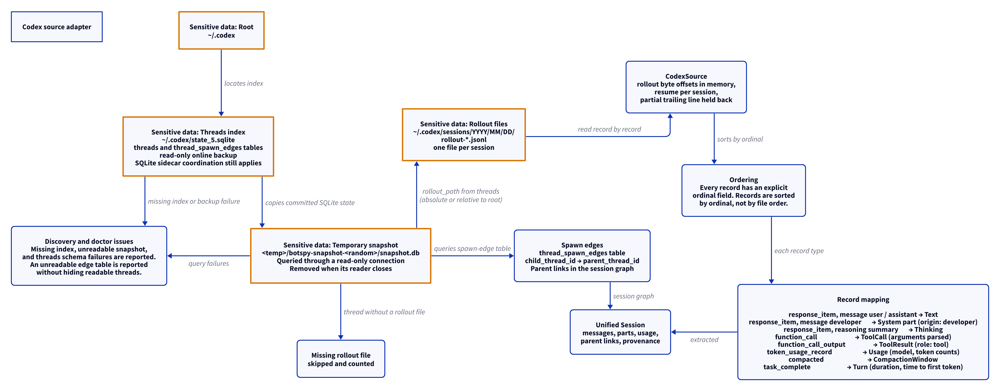

# Codex source adapter

This document uses Simplified Technical English.

The Codex adapter reads the thread index and the rollout files that
Codex keeps under `~/.codex`. The reference registry
(`create_source`) roots Codex at `~/.codex/sessions`; the CLI roots
the adapter at `~/.codex`, where `state_5.sqlite` lives.

## Where the data lives

| Path | Content |
| --- | --- |
| `~/.codex/state_5.sqlite` | The threads index. The adapter reads it through a snapshot copy, never in place. The `threads` query selects `id`, `rollout_path`, `cwd`, `title`, `model`, `git_branch`, `git_origin_url`, `git_sha`, and the created/updated instants. The table has no parent column. |
| `~/.codex/sessions/YYYY/MM/DD/rollout-*.jsonl` | The rollouts. One file holds one session. |

The adapter never opens `~/.codex/thread_history_1.sqlite`. The
rollout byte offsets live in memory, inside the `CodexSource` process
(`set_offset` seeds one by hand, as that index would have recorded
it). A process restart loses the offsets.

## Discovery

1. The adapter snapshots `state_5.sqlite` over a read-only connection
   and reads the `threads` table on the copy. A schema mismatch is an
   issue in `CodexDiscovery`, never a silent empty result.
2. Each thread gives its rollout path. The path may be absolute or
   relative to the root; the adapter resolves both explicitly.
3. A thread with a missing rollout file is skipped and counted.
4. The spawn edges come from the table `thread_spawn_edges`
   (`parent_thread_id`, `child_thread_id`, `status`) and become
   `parent_links` in the session graph. A missing or drifted edge
   table is also an issue, while the threads keep indexing.
5. The thread metadata (title, model, git branch and origin, cwd,
   created/updated instants) maps into `SessionMetadata` (R11) and the
   summary instants.
6. `CodexDiscovery` gives: the thread count, the missing rollouts,
   the parent links, and the issues.

## Extraction and ordering

1. `CodexSource` reads the rollout record by record.
2. Every record carries an explicit `ordinal` field. The ordinal, not
   the file order, is the authoritative order. The adapter sorts by
   ordinal.
3. The adapter keeps a byte offset per session, in memory. The next
   run in the same process resumes at the offset.
4. A partial trailing line is held back until it is complete.

## Record mapping

| Record type | Unified result |
| --- | --- |
| `response_item`, payload message user / assistant | A `Text` part. A user message that the harness injected has origin `harness` (see below) |
| `response_item`, payload message developer | A `System` part with origin developer |
| `response_item`, reasoning summary | A `Thinking` part |
| `function_call` | A `ToolCall` part (call id, name, parsed arguments) |
| `function_call_output` | A `ToolResult` part on a tool-role message |
| `token_usage_record` | Session `Usage`: input, output, cached input, reasoning tokens, and the model |
| `compacted` | A `CompactionWindow`: window id, previous window, retained context |
| `task_complete` | A `Turn`: turn id, duration, time to first token |

## Who wrote a user message

Codex puts its own blocks in the conversation under the user role. The
adapter keeps the role and sets the origin `harness` when the text starts
with `# AGENTS.md instructions` or one of these tags:
`environment_context`, `user_instructions`, `INSTRUCTIONS`,
`codex_internal_context`, `in-app-browser-context`,
`external_codex_apps_open_page`, `turn_aborted`. Any other user message
has no origin. This includes a reply to a question that the agent asked
(`send_user_message_question_reply`): it carries the human's words. The
list is the constant `INJECTED_TAGS` in `src/adapters/codex.rs`.

## Report

`CodexReport` gives: the root, the thread count, the missing rollouts,
and the issues.

## The diagram

<picture>
  <source media="(prefers-color-scheme: dark)" srcset="../diagrams/codex.dark.png">
  
</picture>

## Sensitive data

The adapter reads session content: prompts, replies, reasoning
summaries, tool calls and output, and token usage. Exact paths:

- `~/.codex/state_5.sqlite` — read
- `~/.codex/sessions/YYYY/MM/DD/rollout-*.jsonl` — read

See [`../sensitive-data.md`](../sensitive-data.md).