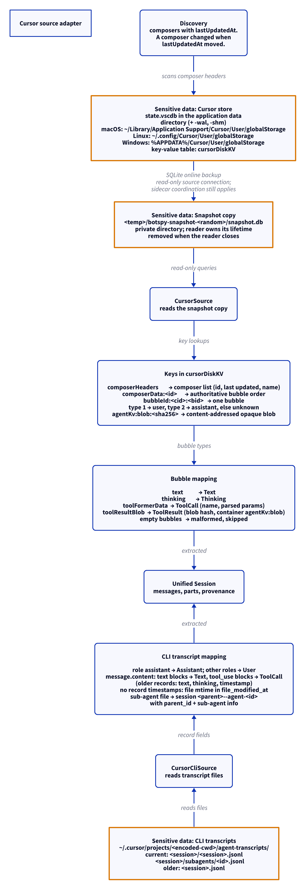

# Cursor source adapter

This document uses Simplified Technical English.

Cursor keeps conversations in two places: the IDE store (a SQLite
key-value database) and the CLI transcripts (JSONL files). BotSpy has
one adapter for each place.

## Where the data lives

| Path | Content |
| --- | --- |
| The IDE store, `state.vscdb` (plus `-wal`, `-shm`) | One table, `cursorDiskKV(key, value)`, holds everything. The path depends on the platform (see below). |
| `User/workspaceStorage/<workspaceId>/workspace.json`, beside `User/globalStorage/` | The folder of one IDE workspace. The adapter reads it, read-only, to find the project of a composer. See the projects section. |
| `~/.cursor/projects/<encoded-cwd>/agent-transcripts/<session>/<session>.jsonl` | A CLI transcript. One file per session. |
| `~/.cursor/projects/<encoded-cwd>/agent-transcripts/<session>/subagents/<id>.jsonl` | A CLI sub-agent transcript. |
| `~/.cursor/projects/<encoded-cwd>/agent-transcripts/<session>.jsonl` | A CLI transcript in the older flat layout. |

## The IDE store path

| Platform | Default path |
| --- | --- |
| macOS | `~/Library/Application Support/Cursor/User/globalStorage/state.vscdb` |
| Linux | `~/.config/Cursor/User/globalStorage/state.vscdb` |
| Windows | `%APPDATA%/Cursor/User/globalStorage/state.vscdb` (`AppData/Roaming` in the home when `APPDATA` is not set) |

The `--home` flag and the `BOTSPY_HOME` variable replace the home
directory. The `--root` flag replaces the whole path. The store can be
very large (6 GB is normal) because the adapter copies it to read it.
See the snapshot section.

## The two sources in `botspy sources`

| Source name | Root | Adapter |
| --- | --- | --- |
| `cursor` | The IDE store file | `CursorSource` |
| `cursor_cli` | `~/.cursor/projects` | `CursorCliSource` |

Both belong to the Cursor agent. The `import` command imports the two
together, because it removes by agent the sessions that a source no
longer reports.

## The snapshot

1. The live store is busy: Cursor writes to it.
2. The adapter copies it with the SQLite online backup API.
3. The copy lands at `$TMPDIR/botspy-cursor-snaps/<pid>-<seq>/snapshot.db`.
4. The copy opens read-only. The live store is never written to.
5. `digest_files` proves that the source was not mutated.
6. The copy is as large as the store. Discovery and `doctor` each make
   one copy. Extracting one composer makes another copy.

## The keys in `cursorDiskKV`

| Key | Value |
| --- | --- |
| `composerHeaders` | The composer list: composer id, last update time, name. Current stores no longer have this key: they keep the list in a `composerHeaders` table (`composerId`, `workspaceId`, `createdAt`, `lastUpdatedAt`, `isArchived`, `isSubagent`, `recency`, `checkpointAt`, `value`, `subagentTypeName`). The adapter reads the key when it exists and the table when it does not. The name is in the `value` JSON. It is the conversation title, never a project. The time is `lastUpdatedAt`, or `createdAt` when that is empty |
| `composerData:<id>` | The composer data. `fullConversationHeadersOnly` gives the authoritative bubble order |
| `bubbleId:<composerId>:<bubbleId>` | One bubble. Type 1 is user, type 2 is assistant, other types are unknown |
| `agentKv:blob:<sha256>` | A content-addressed opaque blob |

## Projects and workspaces

The name of a composer is its conversation title. The adapter never
uses a title as a project. The project comes from the workspace.

1. The `workspaceId` of the composer header names a directory:
   `<store>/../../workspaceStorage/<workspaceId>/`. The store is at
   `User/globalStorage/state.vscdb`, so this is `User/workspaceStorage/`.
2. The adapter resolves a symbolic link in the store path first. The
   workspace directory is beside the real store, not beside the link.
3. The adapter reads `workspace.json` in that directory. It never
   writes to `workspaceStorage`. It reads each workspace id once for
   each `CursorSource` and keeps the result.
4. The file has a `folder` (a `file://` URI) or a `workspace` (the URI
   of a `.code-workspace` file). The adapter decodes the percent
   escapes in the URI into a path.
5. For a `.code-workspace` file, the folder is the directory that holds
   the file. The file name often says nothing (for example
   `workspace`), and the directory is a real folder.
6. `metadata.cwd` is that path. The timeline names the project from the
   last part of it.
7. `project_id` is the workspace id. It is stable and it names nothing.
8. These composers fall under one neutral project, `cursor-no-workspace`,
   with no `cwd`: a composer with no workspace id; a special id such as
   `empty-window` (only ids of 32 hex characters are looked up); an id
   with no directory; a directory with no `workspace.json`; a
   `workspace.json` with no local folder (a remote URI, or Cursor's own
   untitled workspace file). The older `composerHeaders` key has no
   workspace ids, so all its composers fall there.
9. The title is kept in `metadata.title`. It reaches the timeline
   output only with `--titles`.

### Sub-agent composers

A header with `isSubagent` set gives the session sub-agent
information. The kind is `subagentTypeName`, or `subagent` when that is
empty. The depth is empty. The headers name no parent, so `parent_id`
stays unset. The timeline draws the session as a sub-agent. It shows the
"spawned by ... not in this view" note only when `parent_id` is set.

## Bubble mapping

| Bubble field | Unified result |
| --- | --- |
| `text` | A `Text` part |
| `thinking` | A `Thinking` part |
| `toolFormerData` | A `ToolCall` part (name, parsed params) |
| `toolResultBlob` | A `ToolResult` part (blob hash, container `agentKv:blob`) |
| empty bubble | Malformed. Skipped and counted |
| user bubble with `isSimulatedMsg: true` | The message has origin `simulated`. Cursor wrote it, the human did not type it |

## CLI transcripts

1. In the current layout, each session is a directory:
   `agent-transcripts/<session>/<session>.jsonl`. In the older layout,
   `agent-transcripts/<session>.jsonl` is one session. The adapter reads
   both.
2. The current records are `{role, message}` lines. The `message` has
   a `content` list. A `text` block maps to a `Text` part. A `tool_use`
   block maps to a `ToolCall` part (name, input). A record with no role
   (a status record) is skipped and counted as unknown.
3. The older records give role, text, thinking, and timestamp.
4. The role `assistant` maps to an Assistant message. Other roles map
   to User messages.
5. The current records have no timestamps. The session records the
   modification time of the transcript file in `file_modified_at`. This
   time is never copied into the message timestamps. The timeline
   example draws such a session as an approximate span.

### Who wrote a CLI user message

A CLI user text holds the human's words inside `<user_query>`, beside
context that the CLI attached (a `<timestamp>`, open files, skills).

1. When the text has a `<user_query>`, the `Text` part is the query
   alone. The rest of the text is kept in `extra.context`. The message
   has no origin.
2. When the text has no query and holds only a `<timestamp>`, or starts
   with a tag (examples: `dynamic_tools`, `available_subagent_types`,
   `cursor_commands`), there are no human words. The message keeps the
   text and has origin `harness`.
3. Other text (the older flat transcripts) is the human's and has no
   origin.

### Sub-agents

1. A file at `agent-transcripts/<session>/subagents/<id>.jsonl` is a
   sub-agent.
2. It is a session of its own, with the id `<session>--agent-<id>`.
   `extract` accepts this id and the id of the parent.
3. The sub-agent session has `parent_id` set to the parent session and
   sub-agent information with the kind `subagent`. The transcripts do
   not name the kind or the depth, so the depth is empty.
4. `CursorCliDiscovery` counts the transcripts and the sub-agents
   separately.

## Discovery

`CursorDiscovery` gives the composer count and a change flag. A
composer changed when its `lastUpdatedAt` moved. Only changed
composers are extracted again.

## Report

`CursorReport` gives: the store path, the composer count, the bubble
count, and the issues. `CursorCliReport` gives: the root, the transcript
count, the sub-agent count, and the issues.

## The diagram

<picture>
  <source media="(prefers-color-scheme: dark)" srcset="../diagrams/cursor.dark.png">
  
</picture>

## Sensitive data

The adapter reads session content: composer conversations, prompts,
replies, thinking traces, tool blobs. Exact paths:

- The IDE store `state.vscdb` (plus `-wal`, `-shm`) in the Cursor
  application data directory — read through the snapshot copy
- `User/workspaceStorage/<workspaceId>/workspace.json` beside the
  store — read only, for the workspace folder (a path on this machine)
- `$TMPDIR/botspy-cursor-snaps/<pid>-<seq>/snapshot.db` — BotSpy's
  copy of the store
- `~/.cursor/projects/<encoded-cwd>/agent-transcripts/` (session
  directories, sub-agent files, and older flat files) — read

See [`../sensitive-data.md`](../sensitive-data.md).